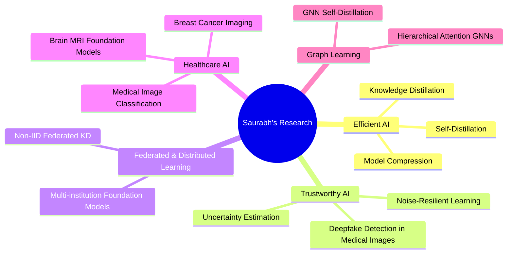

<!-- ============================ HEADER ============================ -->

  

  

  
  
  
  
  

  
  
  

---

## 👨🏻‍🔬 About Me

I'm an **Institute Postdoctoral Fellow** at the **Department of Computational and Data Sciences, Indian Institute of Science (IISc), Bengaluru**, building **foundation models in federated settings** for medicine and healthcare.

- 🧠 **Program Manager, IndiNeuroFM**: a sovereign Indian foundation model for the human brain (TANUH AI-CoE, with >20 medical partners)
- 🎓 **Ph.D., CSE, IIT Patna** (*Efficient Techniques for Knowledge Distillation*) · **PMRF** fellow, 2021–2024
- 🔬 Working on **knowledge distillation**, **federated & privacy-aware learning**, **medical image analysis**, **deepfake detection in medical imaging** and **uncertainty estimation**
- 🏥 Earlier: TANUH Breast Cancer vertical and the Medical Imaging Group (MIG) at IISc · Assistant Professor at KIET · DevOps intern at Myntra
- 🤝 Open to collaborations in **medical AI**, **efficient/distributed learning** and **trustworthy AI**
- ⚡ Fun fact: I love classical music 🎶

 

<b>🗺️ My research map (click to expand)</b>

 

---

## 📰 Recent News

| When | Update |
|:---:|:---|
| 🗓️ 2026 | 🎉 Joined **IISc Bengaluru** as an **Institute Postdoctoral Fellow** (CDS) |
| 🗓️ 2026 | 📄 *Memory Augmented Self Distillation for GNNs* published in **Data Mining and Knowledge Discovery** |
| 🗓️ 2026 | 📄 *Physics-Inspired Fuzzy Self Ensembling* published in **Biomedical Signal Processing and Control** |
| 🗓️ 2026 | 💡 Patent application filed (IISc × Accenture): *determining authenticity of a medical image* |
| 🗓️ 2025 | 🎓 Defended my **Ph.D.** at IIT Patna |
| 🗓️ 2024 | 🏅 **MICCAI 2024** paper + MICCAI **RISE** grant |

---

## 📚 Selected Publications

<b>Journals and conferences</b>

 

- **Taking lessons from history: Memory Augmented Self Distillation for Graph Neural Networks** 
  *Data Mining and Knowledge Discovery*, 2026 · 
- **Walking the Energy Lines: Physics-Inspired Fuzzy Self Ensembling for Medical Image Classification** 
  *Biomedical Signal Processing and Control*, 2026 · 
- **Confidence Matters: Uncertainty-Driven Contrastive Self-Distillation for Medical Image Classification** 
  *MICCAI*, 2024 · 
- **StAlK: Structural Alignment based Self Knowledge Distillation for Medical Image Classification** 
  *Knowledge-Based Systems*, 2024 · 
- **NoRD: Noise-Resilient Self-Distillation through Relative Supervision** 
  *Applied Intelligence*, 2025 · 
- **SCL-IKD: Intermediate Knowledge Distillation via Supervised Contrastive Representation Learning** 
  *Applied Intelligence*, 2023 · 

➡️ Full list on [my website](https://sites.google.com/view/saurabh-sharma/research) and [ORCID](https://orcid.org/0000-0001-9709-5912).

---

## 🛠️ Languages & Tools

  

  
  
  

---

## 📊 GitHub Analytics

<!-- Cards below are generated inside this repo by .github/workflows/profile-cards.yml -->

  
  

  

<!-- Snake animation: generated daily by .github/workflows/snake.yml onto the `output` branch -->

  <picture>
    <source media="(prefers-color-scheme: dark)" srcset="https://raw.githubusercontent.com/philsaurabh/philsaurabh/output/github-snake-dark.svg"/>
    <source media="(prefers-color-scheme: light)" srcset="https://raw.githubusercontent.com/philsaurabh/philsaurabh/output/github-snake.svg"/>
    
  </picture>

---

## 👣 Digital Footprints

  
  
  
  

---

  If something here helped you, <b>please ⭐ the repository</b>, it really helps! 
  For collaborations, reach out on <a href="https://www.linkedin.com/in/philsaurabh/">LinkedIn</a>. <i>Please don't spam.</i> 🙏

  

